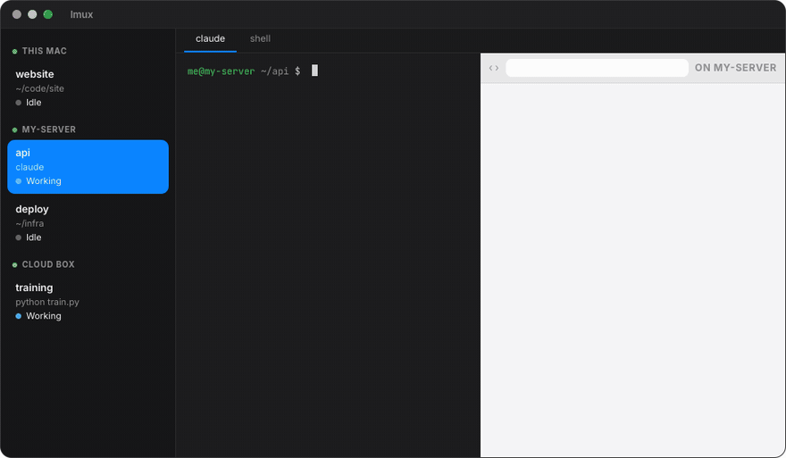

# lmux — lean mux

**cmux + herdr + tmux, with the paid and annoying parts taken out.**

lmux is a workspace app for running coding agents across your own machines. Terminals, browsers and Claude sessions live on the host they run on and keep running when your laptop sleeps. The window on your laptop shows them all in one sidebar.



**[Download for Mac](https://lmux.lintlabs.org)** · macOS 12 or later · Apple silicon · MIT licensed

| From | lmux keeps | lmux drops |
|---|---|---|
| **cmux** | The window: folders and workspaces in a sidebar, splits, tabs, browser panes, notifications, and the agent-control CLI with the same command names | Its cloud VM service, team features, vault and checkpoints, recordings, the iOS simulator, and the ~25 background helpers |
| **herdr** | Persistence: quit, close the lid, lose the network or reboot, and every pane comes back with its directory, scrollback and Claude session | — |
| **tmux** | Every terminal lives in tmux on its host, so it keeps running with no window attached | Having to remember tmux |

## Why it's lean

The same workload in each app on one MacBook Air: each workspace has a terminal printing about 20 lines a second plus an idle split. The figures are what each app added on top of its idle state ([`deploy/bench/stress.py`](deploy/bench/stress.py)).

| | cmux | herdr | lmux |
|---|---|---|---|
| App on disk | 744 MB | 20 MB | 29 MB |
| Memory, 40 workspaces | +698 MB | +208 MB | about +100 MB |
| CPU, 40 workspaces | 15.5% | 5.5% | 10% (the app itself 1.7%) |
| Each command an agent runs | ~170 ms | ~25 ms | ~3 ms |
| Creating 40 workspaces | 11.5 s | 1.8 s | 0.3 s |
| Most tested | 40 workspaces | 40 workspaces | 200 workspaces, 400 live terminals |

herdr is terminals only (no browser panes) and was measured with its TUI client attached, in its own session, with the same script (`deploy/bench/stress.py herdr 5 10 20 40`).

The app draws only the pane on screen. With 400 terminals open and 200 of them printing, its own CPU stayed at 1.9%, the same as idle. macOS's limit of 511 terminals (shared by every app) is reached before lmux's.

## What you get

- **One sidebar for every machine.** This Mac, your servers and cloud boxes appear together, each labelled. A workspace bound to a server runs all its terminals there, with no manual SSH.
- **Remote work costs the laptop almost nothing.** Remote terminals and browsers run on the server. The laptop receives only what's on screen.
- **WebKit browsers on the host.** On a Mac host, pages run in a WKWebView helper; on Linux, in WebKitGTK. Agents on that host drive them, and you watch them live. On this Mac, browser panes are native WebKit views inside the app.
- **Agents in control.** Agents get `send`, `read-screen` and `wait-for`; `browser snapshot`, `click`, `type`, `fill` and `eval`; and `notify` and `set-status`. Claude Code hooks keep each card's status and summary current.
- **Agents come back.** Each tab's Claude session is recorded. After a tmux or machine restart, the tab reopens in its directory and runs `claude --resume <id>`.
- **Move over from cmux in one step.** Use *Import from cmux…* in the command palette, or `lmux import-cmux --move`:
  - folders, splits, tabs, directories and browser pages come over;
  - each idle Claude closes in cmux and resumes in lmux with its conversation;
  - a Claude that's in the middle of a task waits in cmux until it's idle.

## Install

**On your Mac:** download `lmux.dmg` from [lmux.lintlabs.org](https://lmux.lintlabs.org) or the [latest release](https://github.com/lintware/lmux/releases/latest) and drag lmux to Applications. tmux is inside the app. Each release also has a tarball with just the `lmux` CLI and daemon, and checksums.

**From source:**

```sh
deploy/macos/bundle.sh      # builds and installs /Applications/lmux.app and ~/.local/bin/lmux
open -a lmux
```

**On a server** (Linux or macOS, with tmux and a Rust toolchain):

```sh
deploy/install-remote.sh <ssh-host>
```

You can also do this from the app: right-click the sidebar and choose *Add Remote Host…*. The installer builds lmux there, runs the daemon as a user service (systemd or launchd) and adds the Claude Code hooks.

## Use

```sh
lmux new-workspace --name api --cwd ~/code/api
lmux new-split right
lmux send "npm test\n"
lmux wait-for --text "passing"
lmux read-screen --lines 20

lmux browser open https://example.com
lmux browser snapshot -i            # accessibility tree with refs e1, e2, ...
lmux browser click e7

lmux import-cmux --dry-run          # what would come over from cmux
lmux import-cmux --move

lmux --help                         # everything else
```

Inside a pane, `LMUX_WORKSPACE_ID` and `LMUX_SURFACE_ID` are set, so an agent can address its own workspace or the pane next to it.

## How it's built

```
lmux.app (laptop)  ── one websocket per host, over SSH ──▶  lmux server (each host)
  egui + wgpu UI                                              session tree, RPC, persistence
  local panes: a PTY on tmux                                  tmux in control mode
  browser panes: WebKit                                       WebKit helper for the host's pages
```

| Path | What it is |
|---|---|
| `crates/lmux-proto` | Wire types shared by the daemon, CLI and app, and the cmux export reader |
| `crates/lmux-core` | The daemon: session tree, tmux backend, RPC, persistence, browsers |
| `crates/lmux` | The binary: `lmux server` runs the daemon; every other subcommand is a client |
| `app/` | The native client (Rust, egui) |
| `helpers/webkit-mac`, `helpers/webkit-linux` | Run browser pages on a host |
| `deploy/` | App bundle, remote installer, service units, cloud box scripts, stress bench |
| `docs/` | Design notes and reviews |

[PLAN.md](PLAN.md) has the design and milestones.

## Development

```sh
cargo test --workspace          # daemon, CLI and protocol (needs tmux)
(cd app && cargo test)          # the app, including UI tests
```

Work happens on `dev`, and `main` follows it once it's stable.

## Status and roadmap

**Working:**
- terminals, the CLI and the app;
- many hosts in one sidebar;
- local and remote WebKit browsers;
- Claude resume;
- cloud boxes;
- importing from cmux.

**Next:**
- scrollback restored across reboots;
- notifications from every host;
- a cmux parity pass on layout and keys;
- stop tmux sending output for panes nobody is watching.

**Later:** a mobile app for the same hosts, to watch and steer agents from your phone.

## Contributing

Issues and pull requests are welcome. [CONTRIBUTING.md](CONTRIBUTING.md) covers how to set up, run a build beside your real lmux, test, and send a change. The short version: branch from `dev`, run both test suites above, and keep the app lean, so a feature costs the laptop nothing when it isn't on screen.

Releases are listed on the [releases page](https://github.com/lintware/lmux/releases), with notes in [CHANGELOG.md](CHANGELOG.md).

## License

[MIT](LICENSE) © 2026 Lint Technologies Pte. Ltd. (LintLabs)
